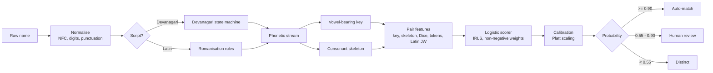

# Milaun <span lang="ne">मिलाउनु</span>

**Offline record linkage for Nepali names across Devanagari and Latin script.**

Milaun (Nepali *milāunu*, "to match") decides whether two name records describe the
same person when one is written `प्रवेश दाहाल` and the other `Prabesh Dahal`. It runs
on a laptop with no GPU, no network access and no third-party dependencies, and it
returns a *calibrated probability* plus the evidence behind it rather than a bare
yes/no.

```
$ milaun compare "प्रवेश दाहाल" "Prabesh Dahal"
Probability: 0.9920  band=match
                'प्रवेश दाहाल' -> key=DAHALPRABES skeleton=DHLPRBS
                'Prabesh Dahal' -> key=DAHALPRABES skeleton=DHLPRBS
Reasons:
  - Phonetic keys are identical.
  - The family-name token matches.
  - The given-name token matches.

$ milaun compare "सीता शर्मा" "Sita Karki"
Probability: 0.0000  band=distinct
```

---

## The problem

Nepali identity records are split across two writing systems, and there is no single
romanisation standard. The same person appears as `Prabesh`, `Pravesh`, `Prabes` or
`प्रवेश`; a surname may be `Dahal`, `Dāhal`, `दाहाल` or `दाहल`. Clerks transcribe by ear,
so aspiration (`Khadka`/`Kadka`), retroflex and dental stops (`ट`/`त`), vowel length
(`ि`/`ी`) and the Nepali final schwa (`Ramesh`/`Ramesha`) all drift.

This is not cosmetic. Nepal Rastra Bank now requires banks to update every customer's
KYC record with National ID details, and the state has begun linking its citizenship
and national-ID databases — both depend on matching a person across records that were
typed by different people at different times ([ICT Frame, July 2026](https://ictframe.com/nrb-mandates-national-id-update/);
[ID Tech Wire, March 2026](https://idtechwire.com/nepal-establishes-interoperability-between-citizenship-and-national-id-systems/)).
Citizens already report difficulty and delay obtaining and correcting identity
documents ([NepalNews, August 2022](https://english.nepalnews.com/s/nation/citizens-facing-problems-getting-nic/)).

The tooling gap is specific. General record-linkage libraries expose edit distance,
Jaro-Winkler and Latin phonetic codes; their comparator catalogue contains no
Devanagari-aware phonetic key, and phonetic codes such as Soundex are defined for
English spelling ([recordlinkage comparison docs](https://recordlinkage.readthedocs.io/en/latest/ref-compare.html)).
An organisation that wants to deduplicate a Nepali beneficiary list today must either
transliterate by hand or accept a large false-merge rate.

**Who this is for:** clinics and hospitals reconciling patient registers, microfinance
and cooperative ledgers, NGOs deduplicating beneficiary lists, municipal registries,
and researchers linking survey waves. All of them work offline, on modest hardware,
with data they are not allowed to upload.

## What Milaun does differently

1. **A Devanagari-native phonetic key.** Both scripts are projected into one canonical
   symbol space; aspiration, retroflex/dental contrast, sibilants, vowel length and the
   `व`/`b`/`w` merger are collapsed deliberately, because Nepali typists collapse them.
2. **Two projections, not one.** Alongside the vowel-bearing key, a *consonant skeleton*
   absorbs epenthetic schwa — the single largest source of mismatch in Nepali names
   (`सापकोटा` vs `Sapkota`). Neither key alone is sufficient; the model combines them.
3. **Calibrated output.** The score is mapped through a fitted calibration curve and
   reported with expected calibration error, so "0.90" has an operational meaning.
4. **Three-band triage.** Automatic match, human review, distinct — plus a Bayes
   decision rule for asymmetric costs (a missed duplicate usually costs more than a
   review).
5. **Blocking with a measured recall cost.** Candidate generation reduces the pair space
   by 96% on the benchmark with 100% pair completeness, and the number is reported
   rather than assumed.
6. **No dependencies, no network.** The core is pure Python standard library. Nothing
   leaves the machine; there is no telemetry and no model download.

## Install

```bash
git clone https://github.com/prabeshdahal/milaun.git
cd milaun
python -m venv .venv
# Windows: .venv\Scripts\activate
source .venv/bin/activate
pip install -e ".[web,dev]"
```

Python 3.10+. The core package needs no third-party libraries; `[web]` adds FastAPI and
Uvicorn, `[dev]` adds pytest and ruff.

## Use

### Command line

```bash
# Explain a single pair (add --json for machine-readable output)
milaun compare "प्रवेश दाहाल" "Prabesh Dahal"

# Show the derived keys for debugging or research
milaun key "Bhattarai"

# Cluster duplicates inside one CSV
milaun dedupe examples/people.csv --name-col name --id-col id --out clusters.csv

# Link two CSV files across systems
milaun link left.csv right.csv --left-col name --right-col name --out pairs.csv

# Keep an audit trail (record ids only, never names)
milaun dedupe people.csv --store audit.db

# Replace a name column with keyed pseudonyms before sharing a file
milaun pseudonymize people.csv --column name --key-file milaun.key --out shared.csv

# Local review UI on http://127.0.0.1:8000
milaun serve
```

### Python

```python
from milaun import Matcher

matcher = Matcher()
result = matcher.compare("प्रवेश दाहाल", "Prabesh Dahal")
print(result.probability, result.band)   # 0.992 match
print(result.reasons)

registry = [
    {"id": "p01", "name": "प्रवेश दाहाल"},
    {"id": "p02", "name": "Prabesh Dahal"},
    {"id": "p03", "name": "सीता शर्मा"},
    {"id": "p04", "name": "Sita Karki"},
]
for cluster in matcher.dedupe(registry)["clusters"]:
    print(cluster["members"], cluster["names"])
```

`dedupe` returns three bands' worth of information: `clusters` (auto-merged),
`review_pairs` (needs a human) and `stats` (blocking and scoring counts).

### Demo

```
$ python examples/demo.py
Loaded 12 records from people.csv

Pairwise checks
------------------------------------------------------------------------
  प्रवेश दाहाल           Prabesh Dahal          p=0.992  match
  सीता शर्मा             Sita Karki             p=0.000  distinct
  अनिता तामाङ            Anita Thapa            p=0.001  distinct
  रमेश ढकाल              Ramesh Dhakal          p=0.992  match

Duplicate clusters
------------------------------------------------------------------------
  cluster p01 (min p=0.992)
    - p01: प्रवेश दाहाल
    - p02: Prabesh Dahal
    - p03: प्रवेश दाहल
  cluster p04 (min p=0.992)
    - p04: सीता शर्मा
    - p05: Sita Sharma
  cluster p06 (min p=0.992)
    - p06: राम बहादुर थापा
    - p07: Ram Bahadur Thapa
  cluster p08 (min p=0.992)
    - p08: रमेश ढकाल
    - p09: Ramesh Dhakal

4 clusters, 9 of 12 records clustered; 15 candidate pairs after blocking.
```

Note what did *not* happen: `Sita Sharma` was not merged with `Sita Karki`, and
`Anita Tamang` was not merged with `Anita Thapa`. A shared given name is weak evidence,
and the benchmark contains explicit same-given/different-family negatives so the model
cannot learn otherwise.

## How it works



| Path | Responsibility |
|---|---|
| `src/milaun/charset.py` | Unicode tables and the canonical symbol alphabet |
| `src/milaun/normalize.py` | NFC, digits, punctuation, script detection |
| `src/milaun/devanagari.py` | One state machine producing both projections |
| `src/milaun/latin.py` | Ordered romanisation rules for Latin spellings |
| `src/milaun/phonetic.py` | Token reduction, vowel-run folding, final schwa, keys |
| `src/milaun/similarity.py` | Edit distance, Jaro-Winkler, Dice, pair features |
| `src/milaun/blocking.py` | Prefix inverted index and pair completeness |
| `src/milaun/model.py` | IRLS logistic regression, non-negative weights |
| `src/milaun/calibration.py` | Platt scaling, isotonic option, ECE, Brier |
| `src/milaun/matcher.py` | Public API: compare, dedupe, link, triage |
| `src/milaun/store.py` | Append-only SQLite audit trail (ids only) |
| `src/milaun/privacy.py` | HMAC pseudonyms, redaction, CSV injection guard |
| `src/milaun/cli.py`, `api.py`, `web/` | CLI, local HTTP API, accessible review UI |

Design notes and trade-offs are in [`docs/ARCHITECTURE.md`](docs/ARCHITECTURE.md);
the problem statement and success metrics are in [`docs/SPEC.md`](docs/SPEC.md).

## Evaluation

Benchmark: 100 hand-written seed identities, expanded into pairs by documented
orthographic operations. `dev` operations (aspiration, retroflex/dental, vowel length,
nasal marks, schwa, romanisation choices) are used for training and calibration.
`hard` operations (nukta, halant removal, sibilant swaps, character typos) are held out
entirely. Negatives include minimal pairs (same surname, one consonant apart) and
same-given-name/different-surname pairs.

| Split | Precision @0.90 | Recall @0.90 | F1 | PR-AUC | ROC-AUC | ECE | Brier |
|---|---|---|---|---|---|---|---|
| dev-test (in-distribution) | 1.000 | 0.867 | 0.929 | 0.987 | 0.993 | 0.030 | 0.032 |
| hard-test (held-out ops) | 1.000 | 0.772 | 0.871 | 0.971 | 0.983 | 0.043 | 0.054 |

Baselines were tuned on the calibration split and then frozen:

| Method | Precision | Recall | F1 | PR-AUC |
|---|---|---|---|---|
| exact match | 0.335 | 1.000 | 0.502 | 0.554 |
| Levenshtein ≥ τ | 0.679 | 0.745 | 0.711 | 0.740 |
| Jaro-Winkler ≥ τ | 0.662 | 0.695 | 0.678 | 0.791 |
| Soundex | 0.903 | 0.788 | 0.842 | 0.782 |
| Latin-only phonetic key | 0.687 | 0.710 | 0.698 | 0.766 |
| **Milaun** | **1.000** | 0.772 | **0.871** | **0.971** |

Other measured properties on the 180-record clustering task: pairwise precision 1.000,
pairwise recall 0.783, cluster purity 1.000 (59/59), under a second of runtime and a few hundred KiB of peak memory;
blocking keeps 100% of true pairs while removing 96.3% of comparisons; scoring runs at
about 3,700 pairs per second on one core.

Reproduce everything:

```bash
python benchmarks/train.py       # refit weights + calibration (~20 s)
python benchmarks/evaluate.py    # writes benchmarks/results/{eval.json,RESULTS.md}
```

**Read this before quoting the numbers.** The dataset is synthetic and derived from
rules, not from real registries. High scores mean "robust to the transformations we
encoded", not "safe to auto-merge in a hospital". A field deployment must re-calibrate
on labelled pairs from its own data. The methodology, threats to validity and the
irreducible homonym floor are documented in [`docs/EVALUATION.md`](docs/EVALUATION.md).

## Limitations

- **Names alone cannot separate homonyms.** Two different people called `Sita Sharma`
  score 1.0 by construction (measured: 20/20 in the probe). Combine with date of birth,
  address, guardian name or an identifier; Milaun is a blocking and triage aid, not a
  biometric.
- **The benchmark is synthetic.** It cannot estimate field accuracy. Real error
  distributions are correlated (a single clerk mistypes consistently) and include
  nicknames, clan names and honorifics that the generator does not model.
- **Nepali-centric.** The rule set was designed for Nepali orthography and Nepali
  romanisation habits. Hindi, Marathi or Bengali names will partially work but were not
  evaluated; the `व`/`b` merger in particular is a Nepali choice.
- **No learned transliteration.** Rare spellings that break the phonetic rules are
  handled by similarity features, not by a trained model. See the failure examples in
  `benchmarks/results/eval.json`.
- **Conservative by design.** At the 0.90 band, roughly a fifth of true matches in the
  held-out split are not auto-merged; most land in review. That is the intended
  trade-off for identity data.

## Security and privacy

- No network calls anywhere in the core or CLI; the web UI binds to `127.0.0.1`.
- The audit store has **no name column** — only record ids, probabilities and features.
- `pseudonymize` produces keyed HMAC-SHA256 pseudonyms for sharing datasets; the key file
  is created with owner-only permissions.
- CSV export neutralises spreadsheet formula injection.
- Threat model, including what pseudonymisation does *not* protect against, is in
  [`docs/THREAT_MODEL.md`](docs/THREAT_MODEL.md). Report vulnerabilities per
  [`SECURITY.md`](SECURITY.md).

## Tests

```bash
pytest            # 127 tests, ~1 s
ruff check .
```

The suite covers Unicode normalisation (including the combining-mark regression that a
`\w`-based filter causes), cross-script key agreement, every similarity primitive,
blocking recall, calibration, CLI exit codes, API validation, the audit store, and the
benchmark's own guarantees (determinism, split isolation, tie-aware PR-AUC).

## Roadmap

See [`docs/ROADMAP.md`](docs/ROADMAP.md). The short version: a small hand-labelled
real-world evaluation set, a date-of-birth/address comparator, optional learned
transliteration for rare spellings, and a Nepali-language UI. Beginner-friendly issues
are listed in [`docs/GOOD_FIRST_ISSUES.md`](docs/GOOD_FIRST_ISSUES.md).

## Contributing

Contributions are welcome, especially from people with access to real (consented,
de-identified) registry data who can report failures. Start with
[`CONTRIBUTING.md`](CONTRIBUTING.md) and [`CODE_OF_CONDUCT.md`](CODE_OF_CONDUCT.md).

## License

MIT — see [`LICENSE`](LICENSE).

## Citation

```bibtex
@software{dahal2026milaun,
  author  = {Dahal, Prabesh},
  title   = {Milaun: offline record linkage for Nepali names across Devanagari and Latin script},
  year    = {2026},
  version = {0.1.0},
  license = {MIT},
  url     = {https://github.com/prabeshdahal/milaun}
}
```

A `CITATION.cff` is included for GitHub's citation widget.

