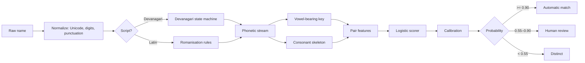

# Milaun (मिलाउनु)

**Offline record linkage for Nepali names written in Devanagari and Latin script.**

Milaun helps determine whether two name records may refer to the same person when the names are written differently—for example, `प्रवेश दाहाल` and `Prabesh Dahal`. It is designed to run locally on modest hardware, without a GPU, network access, or third-party dependencies in its core package.

Instead of returning only a yes/no answer, Milaun provides a score, a decision band, and human-readable evidence for the comparison.

```text
$ milaun compare "प्रवेश दाहाल" "Prabesh Dahal"
Probability: 0.9920  band=match
  'प्रवेश दाहाल' -> key=DAHALPRABES skeleton=DHLPRBS
  'Prabesh Dahal' -> key=DAHALPRABES skeleton=DHLPRBS
Reasons:
  - Phonetic keys are identical.
  - The family-name token matches.
  - The given-name token matches.

$ milaun compare "सीता शर्मा" "Sita Karki"
Probability: 0.0000  band=distinct
```

> **Important:** Milaun is a record-linkage aid, not proof of identity. Its current benchmark is synthetic; real-world use requires evaluation and calibration on appropriately governed, labelled data from the target setting.

## Why Milaun?

Nepali names appear in records across two writing systems, and romanisation is not consistent. The same person may be recorded as `Prabesh`, `Pravesh`, `Prabes`, or `प्रवेश`. Surnames can also vary, as in `Dahal`, `Dāhal`, `दाहाल`, and `दाहल`.

These differences are often caused by ordinary data-entry and transcription variation: aspiration (`Khadka` / `Kadka`), retroflex and dental consonants (`ट` / `त`), vowel length (`ि` / `ी`), and the final schwa sometimes represented in Latin spellings (`Ramesh` / `Ramesha`). A generic string comparison can miss valid matches or incorrectly join unrelated people.

This matters for organisations that maintain records across systems. Banks, clinics, cooperatives, NGOs, municipalities, and researchers may need to reconcile records while keeping sensitive data on local machines. Relevant context includes [Nepal Rastra Bank's National ID KYC update coverage](https://ictframe.com/nrb-mandates-national-id-update/), reporting on links between citizenship and national-ID systems ([ID Tech Wire](https://idtechwire.com/nepal-establishes-interoperability-between-citizenship-and-national-id-systems/)), and reporting on difficulties obtaining or correcting identity documents ([NepalNews](https://english.nepalnews.com/s/nation/citizens-facing-problems-getting-nic/)).

General record-linkage tools commonly offer edit distance, Jaro–Winkler, and Latin-oriented phonetic comparisons. Milaun focuses on the specific problem of comparing Nepali names across Devanagari and Latin script.

### Intended use cases

- Hospitals reconciling patient registers
- Microfinance institutions and cooperatives matching client records
- NGOs deduplicating beneficiary lists
- Municipal registries comparing records across systems
- Researchers linking records across survey waves

These use cases often involve sensitive information, limited computing resources, and environments where uploading data to an external service is not appropriate.

## What makes Milaun different?

1. **Devanagari-aware phonetic representation.** Names from both scripts are mapped into a shared canonical symbol space. The rules deliberately account for selected distinctions that frequently vary in Nepali data entry, including aspiration, retroflex/dental contrasts, sibilants, vowel length, and some `व` / `b` / `w` variation.
2. **Two complementary keys.** Milaun derives a vowel-bearing phonetic key and a consonant skeleton. The skeleton helps tolerate vowel and final-schwa variation, such as `सापकोटा` and `Sapkota`. The matcher combines evidence from both rather than relying on either one alone.
3. **Calibrated scoring.** A fitted calibration step maps the model score to a probability estimate. Evaluation reports expected calibration error (ECE) and Brier score. Calibration quality still depends on the data used to fit and evaluate it.
4. **Three-band triage.** Results are grouped into automatic match, human review, and distinct bands. A Bayes decision rule can also account for different costs of false matches and missed duplicates.
5. **Measured candidate blocking.** Candidate generation reduces the number of comparisons. The included synthetic benchmark reports both the reduction and pair completeness, rather than assuming that blocking is lossless.
6. **Local-first operation.** The core uses the Python standard library and does not make network calls. There is no telemetry or model download in the core workflow.

## Installation

Milaun supports Python 3.10 and later.

```bash
git clone https://github.com/prabeshdahal/milaun.git
cd milaun
python -m venv .venv
```

Activate the environment:

```bash
# Windows
.venv\Scripts\activate

# macOS / Linux
source .venv/bin/activate
```

Install the package with the optional web interface and development tools:

```bash
pip install -e ".[web,dev]"
```

The core package does not require third-party libraries. The `web` extra installs FastAPI and Uvicorn; the `dev` extra installs pytest and Ruff.

## Usage

### Command line

Compare a pair of names and inspect the evidence:

```bash
milaun compare "प्रवेश दाहाल" "Prabesh Dahal"
```

Return machine-readable JSON:

```bash
milaun compare "प्रवेश दाहाल" "Prabesh Dahal" --json
```

Inspect the derived key for a name:

```bash
milaun key "Bhattarai"
```

Find duplicate clusters in a CSV file:

```bash
milaun dedupe examples/people.csv --name-col name --id-col id --out clusters.csv
```

Link records across two CSV files:

```bash
milaun link left.csv right.csv --left-col name --right-col name --out pairs.csv
```

Store an audit trail containing record IDs rather than names:

```bash
milaun dedupe people.csv --store audit.db
```

Replace a name column with keyed pseudonyms before sharing a file:

```bash
milaun pseudonymize people.csv --column name --key-file milaun.key --out shared.csv
```

Start the local review interface:

```bash
milaun serve
```

The interface is served at `http://127.0.0.1:8000`.

### Python API

```python
from milaun import Matcher

matcher = Matcher()
result = matcher.compare("प्रवेश दाहाल", "Prabesh Dahal")

print(result.probability, result.band)
print(result.reasons)

records = [
    {"id": "p01", "name": "प्रवेश दाहाल"},
    {"id": "p02", "name": "Prabesh Dahal"},
    {"id": "p03", "name": "सीता शर्मा"},
    {"id": "p04", "name": "Sita Karki"},
]

result = matcher.dedupe(records)
for cluster in result["clusters"]:
    print(cluster["members"], cluster["names"])
```

`dedupe` returns:

- `clusters`: records assigned to automatic-match clusters
- `review_pairs`: candidate pairs that need human review
- `stats`: blocking and scoring statistics

### Example output

The included demo loads 12 sample records and checks selected pairs:

```text
Pairwise checks
------------------------------------------------------------------------
  प्रवेश दाहाल             Prabesh Dahal          p=0.992  match
  सीता शर्मा               Sita Karki             p=0.000  distinct
  अनिता तामाङ              Anita Thapa            p=0.001  distinct
  रमेश ढकाल                Ramesh Dhakal          p=0.992  match
```

It also groups likely duplicates into clusters. In the sample data, `Sita Sharma` is not merged with `Sita Karki`, and `Anita Tamang` is not merged with `Anita Thapa`. A shared given name is weak evidence; the benchmark includes negative examples with the same given name and different surnames.

Run the demo with:

```bash
python examples/demo.py
```

The exact output depends on the checked-out version and example data.

## How it works



The main modules are organised by responsibility:

| Module | Responsibility |
|---|---|
| `src/milaun/charset.py` | Unicode tables and canonical symbol alphabet |
| `src/milaun/normalize.py` | NFC normalization, digits, punctuation, and script detection |
| `src/milaun/devanagari.py` | State machine that produces both phonetic projections |
| `src/milaun/latin.py` | Ordered romanisation rules for Latin spellings |
| `src/milaun/phonetic.py` | Token reduction, vowel-run folding, final schwa, and key generation |
| `src/milaun/similarity.py` | Edit distance, Jaro–Winkler, Dice similarity, and pair features |
| `src/milaun/blocking.py` | Prefix inverted index and pair-completeness measurement |
| `src/milaun/model.py` | IRLS logistic regression with non-negative weights |
| `src/milaun/calibration.py` | Platt scaling, optional isotonic calibration, ECE, and Brier score |
| `src/milaun/matcher.py` | Public API for compare, dedupe, link, and triage |
| `src/milaun/store.py` | Append-only SQLite audit trail using record IDs only |
| `src/milaun/privacy.py` | HMAC pseudonyms, redaction, and CSV-injection protection |
| `src/milaun/cli.py`, `api.py`, `web/` | CLI, local HTTP API, and review interface |

For implementation decisions and requirements, see [`docs/ARCHITECTURE.md`](docs/ARCHITECTURE.md) and [`docs/SPEC.md`](docs/SPEC.md).

## Evaluation

### Benchmark design

The included benchmark starts with 100 hand-written seed identities and generates comparison pairs using documented spelling transformations. The `dev` transformations—such as aspiration, retroflex/dental variation, vowel length, nasal marks, schwa variation, and romanisation choices—are used for training and calibration. The `hard` transformations—such as nukta changes, halant removal, sibilant substitutions, and character typos—are held out for evaluation.

Negative examples include minimal pairs (for example, surnames with a one-consonant difference) and pairs sharing a given name but having different surnames.

### Reported results

| Split | Precision @ 0.90 | Recall @ 0.90 | F1 | PR-AUC | ROC-AUC | ECE | Brier |
|---|---:|---:|---:|---:|---:|---:|---:|
| Dev-test (in-distribution) | 1.000 | 0.867 | 0.929 | 0.987 | 0.993 | 0.030 | 0.032 |
| Hard-test (held-out transformations) | 1.000 | 0.772 | 0.871 | 0.971 | 0.983 | 0.043 | 0.054 |

Baselines were tuned on the calibration split and then frozen:

| Method | Precision | Recall | F1 | PR-AUC |
|---|---:|---:|---:|---:|
| Exact match | 0.335 | 1.000 | 0.502 | 0.554 |
| Levenshtein threshold | 0.679 | 0.745 | 0.711 | 0.740 |
| Jaro–Winkler threshold | 0.662 | 0.695 | 0.678 | 0.791 |
| Soundex | 0.903 | 0.788 | 0.842 | 0.782 |
| Latin-only phonetic key | 0.687 | 0.710 | 0.698 | 0.766 |
| **Milaun** | **1.000** | **0.772** | **0.871** | **0.971** |

On the reported 180-record clustering task, the project reports pairwise precision of 1.000, pairwise recall of 0.783, cluster purity of 1.000 (59/59), runtime below one second, and peak memory use of a few hundred KiB. Blocking retained all true pairs in that benchmark while reducing comparisons by 96.3%; scoring ran at approximately 3,700 pairs per second on one core.

Reproduce the evaluation with:

```bash
python benchmarks/train.py
python benchmarks/evaluate.py
```

The training script refits model weights and calibration. The evaluation script writes `benchmarks/results/eval.json` and `benchmarks/results/RESULTS.md`.

> **How to interpret these numbers:** The benchmark is synthetic and generated from predefined spelling rules; it is not a sample of real government, hospital, bank, or NGO registries. These results measure robustness to the transformations represented in the benchmark, not field accuracy or readiness for automatic identity decisions. Before deployment, evaluate and recalibrate the matcher with labelled, consented, de-identified examples representative of the intended data. See [`docs/EVALUATION.md`](docs/EVALUATION.md) for methodology, threats to validity, and the homonym limitation.

## Limitations

- **Names cannot disambiguate every person.** Two different people named `Sita Sharma` can receive a perfect name-match score. Combine name evidence with other appropriate fields—such as date of birth, address, guardian name, or an identifier—when permitted. Milaun is a record-linkage and triage tool, not a biometric or proof of identity.
- **The benchmark is synthetic.** It cannot estimate accuracy on real records. Real-world errors may be correlated and may include nicknames, clan names, honorifics, and spelling patterns not covered by the generator.
- **The rules are Nepali-centric.** Other Indic-language names may partially work, but Hindi, Marathi, and Bengali names have not been evaluated. Some mappings, including the `व` / `b` / `w` merger, are deliberate choices for Nepali usage.
- **No learned transliteration model is included.** Rare spellings that do not follow the rules are handled through similarity features rather than a trained transliteration model.
- **Automatic matching is conservative.** At the 0.90 threshold, the held-out benchmark does not auto-match roughly one-fifth of true matches. Many are sent to review; this is an intentional trade-off to reduce risky automatic merges.

## Security and privacy

- The core package and CLI do not make network calls; the web interface binds to `127.0.0.1`.
- The audit store does not save a name column. It stores record IDs, probabilities, and features.
- `pseudonymize` creates keyed HMAC-SHA256 pseudonyms. The key file is created with owner-only permissions where supported by the platform.
- CSV exports neutralize spreadsheet formula injection.
- Pseudonymisation does not make a dataset anonymous in every context. Review the threat model and protect input files, outputs, keys, backups, and logs appropriately.

Read [`docs/THREAT_MODEL.md`](docs/THREAT_MODEL.md) for the threat model and [`SECURITY.md`](SECURITY.md) for vulnerability reporting.

## Tests and code quality

Run the test suite and linter:

```bash
pytest
ruff check .
```

The project README reports 127 tests. Coverage includes Unicode normalization, cross-script key agreement, similarity functions, blocking recall, calibration, CLI exit codes, API validation, the audit store, and benchmark guarantees such as determinism, split isolation, and tie-aware PR-AUC.

## Roadmap

See [`docs/ROADMAP.md`](docs/ROADMAP.md). Planned directions include:

- A small, hand-labelled evaluation set based on real-world examples with appropriate consent and de-identification
- Date-of-birth and address comparators
- Optional learned transliteration for rare spellings
- A Nepali-language user interface

Beginner-friendly tasks are listed in [`docs/GOOD_FIRST_ISSUES.md`](docs/GOOD_FIRST_ISSUES.md).

## Contributing

Contributions are welcome, especially from people who can report matching failures using real, consented, de-identified examples.

Before contributing, read [`CONTRIBUTING.md`](CONTRIBUTING.md) and [`CODE_OF_CONDUCT.md`](CODE_OF_CONDUCT.md). Please do not submit sensitive personal records or unconsented identity data in issues or pull requests.

## License

Milaun is released under the MIT License. See [`LICENSE`](LICENSE).

## Citation

```bibtex
@software{dahal2026milaun,
  author  = {Dahal, Prabesh},
  title   = {Milaun: offline record linkage for Nepali names across Devanagari and Latin script},
  year    = {2026},
  version = {0.1.0},
  license = {MIT},
  url     = {https://github.com/prabeshdahal/milaun}
}
```

A `CITATION.cff` file is included for GitHub's citation widget.
